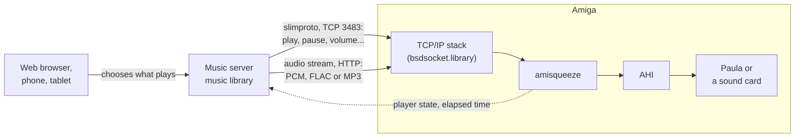

# Amiga Network Music

**Network music for classic Amigas**: the Amiga becomes a Squeezebox player, playing the music of a server on
your local network and driven like any other player in the house.

 |
AmigaOS 3.x | 68020 or better | sound through AHI | MIT licence

## How it works

amisqueeze needs a **music server** on the local network. The server holds the music library, web radios and
streaming services, and streams them to its players. A web browser, a phone or a tablet chooses what plays where.
The server sees the Amiga as one more Squeezebox, through slimproto, the protocol of Squeezebox players.
amisqueeze receives the music, decodes it if needed and plays it through AHI.

## Supported servers

| Server | | Status |
|---|---|---|
| [Lyrion Music Server](https://lyrion.org) (LMS) | the original Squeezebox server, formerly Logitech Media Server; free and open source; Windows, macOS, Linux, NAS, Raspberry Pi, Docker | **tested** (9.1.1) |
| [Music Assistant](https://music-assistant.io) | a server for many kinds of players, Squeezebox among them; free and open source; inside Home Assistant, or standalone in Docker | **tested** (2.10.7) |

## What the Amiga needs

- **AmigaOS 3.x** and a **68020 or better**: from a plain 68020 accelerator to a PiStorm.
- About **1.7 MB of free memory**.
- A **TCP/IP stack** providing `bsdsocket.library`: Roadshow, Miami, AmiNetXDuo, AmiTCP, or WinUAE's emulation.
- **AHI**, the standard Amiga audio system, with the driver of Paula or of a sound card. It is free, on Aminet,
  but not part of AmigaOS 3.x.

## Quick start

1. **Download** the zip or the `.lha` of the latest
   [release](https://github.com/shadow38/amiga-network-music/releases).
2. **Copy the executable** with its icon (`.info`) into a drawer, or into `C:` to run it from a Shell:
   `amisqueeze` for any Amiga with a 68020 or better, `amisqueeze.fpu` for an Amiga with an FPU, which also decodes
   MP3.
3. **Set up AHI**: unit 0 in a "stereo++" mode in `SYS:Prefs/AHI` (with Paula: `Paula:14 bit stereo++`).
   Without "++", the music plays on one side only. See [sound](docs/user-guide.md#sound-ahi).
4. **Open the server's ports** to the Amiga: 3483 tcp and udp, and 9000/tcp for LMS or 8097/tcp for Music
   Assistant. MP3, or a slow Amiga, may need a setting on the server: see
   [settings for your Amiga](docs/user-guide.md#settings-for-your-amiga).
5. **Start amisqueeze**, with the TCP/IP stack running: double-click its icon, or type `amisqueeze` in a Shell.
   It finds the server on the local network by itself. A player called "Amiga" then shows up in the server's web
   interface: choose it there or in an app, and play.

If no server is found, give its address: `amisqueeze SERVER=192.168.1.10`, or the ToolType of the same name. To
stop amisqueeze: Ctrl-C in its window, or Remove in Exchange. See
[starting](docs/user-guide.md#starting-amisqueeze) and [stopping](docs/user-guide.md#stopping-amisqueeze).

Everything else (all the options, sound settings, volume, messages) is in the **[user guide](docs/user-guide.md)**.

## Status

**amisqueeze** works:

- plays from LMS and Music Assistant: play, pause, seek, stop, next track without a gap, volume;
- raw PCM up to 48 kHz; FLAC and MP3 decoded on the Amiga when its CPU is fast enough (MP3 with
  `amisqueeze.fpu`), otherwise converted by the server;
- recovers from a slow or broken stream and from a server restart;
- starts from a Shell or from the Workbench, at boot too; Exchange lists it, shows and hides its window, and stops
  it.

Tested in WinUAE and on a real A1200 with a 26 MHz 68020, where CD-quality playback takes about three quarters of
the CPU. The user guide lists [what has been tried](docs/user-guide.md#what-has-been-tried), the
[known limits](docs/user-guide.md#known-limits) and some [troubleshooting](docs/user-guide.md#troubleshooting).
What changed in each version: the [changelog](CHANGELOG.md).

**Tried it on another Amiga?** Please tell, whether it plays or not, in an
[issue](https://github.com/shadow38/amiga-network-music/issues). Give the CPU, the AmigaOS version, the TCP/IP
stack, the sound output and the server. With a problem, add a log: `amisqueeze VERBOSE LOG=RAM:amisqueeze.log`.

## For developers

- **[CONTRIBUTING.md](CONTRIBUTING.md)**: building (cross-compiler, `make`, `make dist`), the tests (`make test`,
  also run by GitHub on each push), testing in WinUAE, the repository layout, and a build of the version in
  development (the `dev` branch).
- **[Architecture](docs/development/architecture.md)**: how amisqueeze works, and why this way.
- **[Development plan](docs/development/README.md)**: the roadmap and the design decisions.

## Licence

**MIT**, see [LICENSE](LICENSE).

- amisqueeze is written from scratch from the protocol's description. squeezelite and LMS (GPL) served as
  references for the protocol's behaviour, not as a source of code.
- Third-party code, in `third_party/`, each with a README giving its origin and licence:
  - [dr_flac](https://github.com/mackron/dr_libs) (FLAC decoding): public domain (Unlicense) or MIT No Attribution;
  - [minimp3](https://github.com/lieff/minimp3) (MP3 decoding): CC0 1.0, a public domain dedication.
