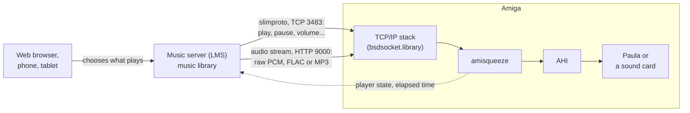

# Amiga Network Music

**Network music for classic Amigas**: the Amiga becomes a Squeezebox player, playing the music of a server on
your local network and driven like any other player in the house.

[](https://github.com/shadow38/amiga-network-music/actions/workflows/tests.yml)
· AmigaOS 3.x · 68020 or better · sound through AHI · MIT licence

## How it works

A **music server** holds the music library (files on a PC, a NAS or a Raspberry Pi; web radios and streaming
services through plugins) and streams it to **players**. A web browser, a phone or a tablet chooses what plays
where.

The Amiga becomes one of these players through **slimproto**, the protocol of Logitech's Squeezebox players, now
spoken by free software on both sides.



amisqueeze takes the server's commands, receives the music as an HTTP stream, decodes it if needed (FLAC, MP3 on
a fast Amiga; otherwise the server sends raw PCM) and plays it through AHI.

## Supported servers

| Server | | Status |
|---|---|---|
| [Lyrion Music Server](https://lyrion.org) (LMS) | the free, open-source Squeezebox server, formerly Logitech Media Server, now developed by its community; Windows, macOS, Linux, NAS, Raspberry Pi, Docker | **tested** (9.1.1) |
| [Music Assistant](https://music-assistant.io) | a more recent server, close to Home Assistant, which drives Squeezebox players with the same protocol | not tested yet |

## Programs

- **amisqueeze**: the player. Like squeezelite on a PC, the server sees it as one more Squeezebox, controlled from
  its web interface, its apps or any Squeezebox remote; the sound goes through AHI (Paula or a sound card). A
  software player, without a display or infrared remote.
- **amilms**: a remote control from the Amiga (not started yet).

### What the Amiga needs

- **AmigaOS 3.x** and a **68020 or better**: from a plain 68020 accelerator to a PiStorm.
- A **TCP/IP stack** providing `bsdsocket.library`: Roadshow, AmiTCP, AmiNetXDuo, or WinUAE's emulation.
- **AHI**, the standard Amiga audio system, with the driver of Paula or of a sound card. It is free, on Aminet,
  but not part of AmigaOS 3.x.

## Quick start

1. **Download** the zip of the latest [release](https://github.com/shadow38/amiga-network-music/releases)
   (0.5: a preview tested in WinUAE only, not yet on a real Amiga). It holds amisqueeze and the user guide;
   what changed from one version to the next is in the [changelog](CHANGELOG.md).
2. **Pick the executable**: `amisqueeze` for any Amiga with a 68020 or better; `amisqueeze.fpu` for an Amiga
   with an FPU, which also decodes MP3. Copy it with its icon (`.info`) into a drawer to start it from the
   Workbench, or into `C:` to run it from a Shell.
3. **On the Amiga**: a TCP/IP stack running, and AHI installed, with unit 0 set to a "stereo++" mode in
   `SYS:Prefs/AHI` (with Paula: `Paula:14 bit stereo++`); without "++", the music plays on one side only. Where to
   get AHI and how to set it up: [sound](docs/user-guide.md#sound-ahi).
4. **Start it**, with the address of the server:
   - from the **Workbench**: select the icon, *Icons > Information…*, and in its ToolTypes turn
     `(SERVER=192.168.1.10)` into your server's address (without the parentheses); then double-click the icon.
     A window shows its messages. Copied into `SYS:WBStartup`, it starts with the Amiga;
   - from a **Shell**:

     ```
     amisqueeze SERVER=192.168.1.10
     ```

   A player called "Amiga" shows up in LMS: choose it in the web interface or an app, and play.
5. **To stop it**: Exchange, the system's list of background programs, lists it ("Remove"); or Ctrl-C in its
   window or Shell. To keep the Shell options for the next times, then just type `amisqueeze`:

   ```
   Echo "SERVER=192.168.1.10 NAME=Amiga" >ENV:amisqueeze.prefs
   Copy ENV:amisqueeze.prefs ENVARC:
   ```

On the server side: LMS reachable from the Amiga (ports 3483 and 9000), and, for MP3 files on an Amiga that does
not decode them, a conversion rule: see [server setup](docs/user-guide.md#server-setup).

Everything else (all the options, sound settings, volume, messages) is in the **[user guide](docs/user-guide.md)**.

## Status

Under development, in testable steps described in the [development plan](docs/development/README.md). Written in
C, cross-compiled; tested in WinUAE, not yet on a real Amiga.

**amisqueeze** works:

- **as a player**: it shows up in LMS and plays through AHI; play, pause, seek, stop, next track without a gap,
  volume;
- **raw PCM**: 8 to 32 bits, mono or stereo, up to 48 kHz;
- **FLAC**: decoded on the Amiga when the CPU is fast enough (a PiStorm-class CPU, measured at start-up), otherwise
  converted by the server;
- **MP3**: decoded on the Amiga by `amisqueeze.fpu` (Amigas with an FPU) when it is fast enough, otherwise
  converted by the server;
- **robustness**: it recovers from a slow or broken stream and from a server restart;
- **on the Amiga**: started from a Shell or from the Workbench (icon, options in its ToolTypes, at boot from
  `SYS:WBStartup`), listed in Exchange, which stops it; a log file (`LOG`) if wanted.

Tested in WinUAE with emulated networking and LMS 9.1.1: listening, one hour of playback. On a 28 MHz 68020, sound
through AHI and Paula takes about two thirds of the CPU. The user guide lists
[what has been tried](docs/user-guide.md#requirements), the [known limits](docs/user-guide.md#known-limits) and
some [troubleshooting](docs/user-guide.md#troubleshooting).

**amilms**: not started.

## For developers

Building (cross-compiler, `make`, `make dist`), the host build and its tests (`make test`, also run by GitHub on
each push), testing in WinUAE, the repository layout: **[CONTRIBUTING.md](CONTRIBUTING.md)**.
The roadmap and the design decisions are in the [development plan](docs/development/README.md).

## Licence

MIT, see [LICENSE](LICENSE). amisqueeze is written from scratch from the protocol description; squeezelite and
LMS (GPL) are used as references for the protocol's behaviour, not as a source of code. Third-party code, in
`third_party/` (each with a README giving its origin and licence): dr_flac (FLAC decoding), public domain or MIT No
Attribution; minimp3 (MP3 decoding), CC0 1.0 (public domain dedication).
