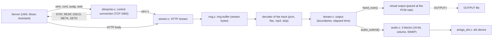
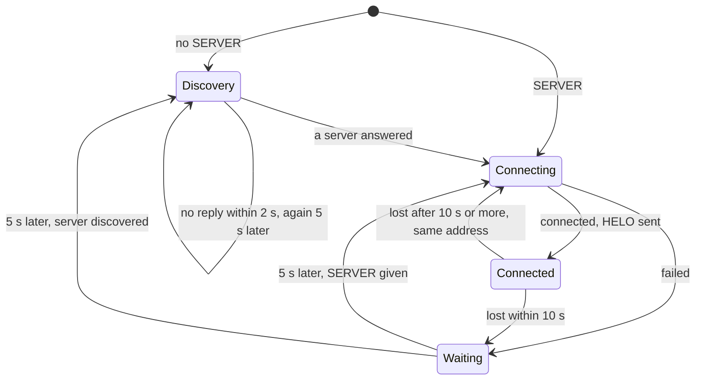
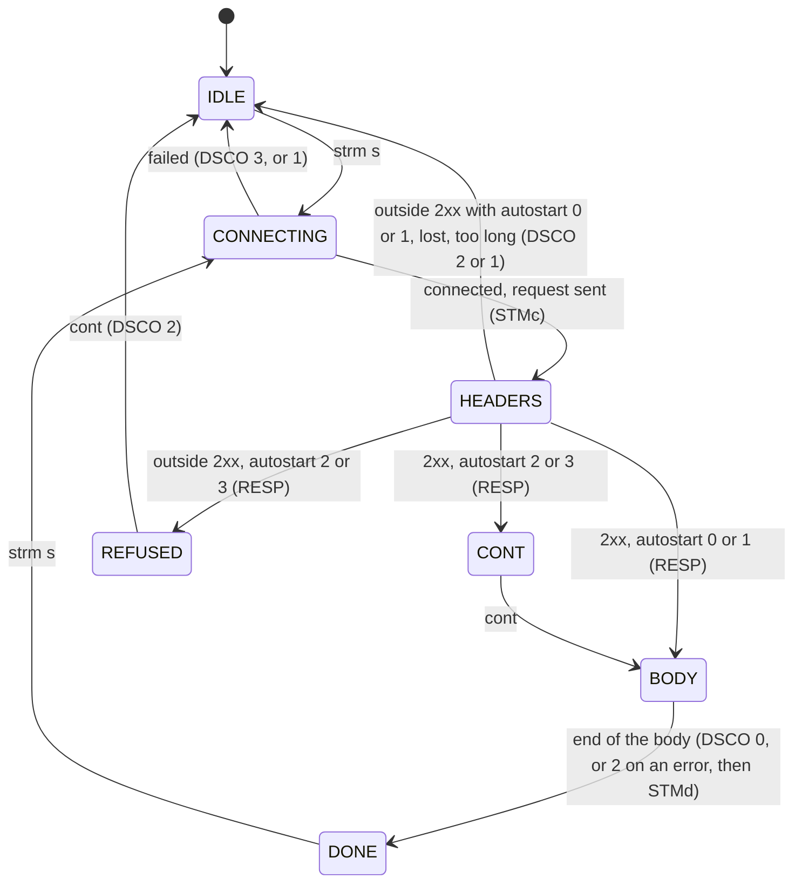
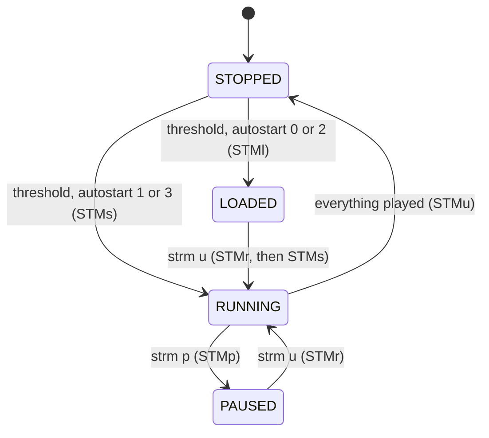

# Architecture of amisqueeze

For contributors: how amisqueeze works, and why this way. The code comments give the details; this page gives the
picture. What the servers send and what amisqueeze answers, with a glossary of slimproto's words, is in
[protocol.md](protocol.md). Building and testing are in [building.md](building.md) and [testing.md](testing.md),
the steps and their decisions in the [plan](README.md).

## The picture

amisqueeze is a Squeezebox player. A server (LMS or Music Assistant) tells it what to play, and it fetches the
sound itself. It runs as one task, with two connections to the server, one buffer and one output:

- the control connection (slimproto, TCP 3483) carries the server's commands and the player's statuses;
- the HTTP stream brings a track's bytes into the ring buffer;
- the decoder of each track turns them into PCM, which the output hands to AHI or to the virtual output.

## Source files and builds

The **portable core** is every file of `src/amisqueeze/` but `amiga*.c` and `posix.c`. It is standard C, with no
Amiga or POSIX header. Whatever touches the system goes through `platform.h`: sockets, clock, files, the audio
device, the wait.

| File | Role |
|---|---|
| `player.c` | set-up from the options, the main loop, reconnection, the FLAC and MP3 decision at start-up; the parts of the Amiga start-up that need no system (ToolTypes, window specification, message history, close gadget's event), so that the unit tests reach them |
| `slimproto.c` | the control connection: framing; the packets received (`strm`, `cont`, `audg`, `setd`...) and sent (`HELO`, `STAT`, `RESP`, `DSCO`, `META`, `SETD`); server discovery |
| `stream.c` | the HTTP stream, the queue of tracks, the output (which decoder runs, track boundaries, elapsed time, statuses), the virtual output |
| `icy.c` | an internet radio's parts that need no system: the HTTP status line, the metadata blocks taken out of the sound, the title in them |
| `ring.c` | the 1 MB ring buffer of stream bytes |
| `decoder.c`, `flac.c`, `mp3.c` | the decoders: raw PCM (and a WAV header), FLAC (dr_flac), MP3 (minimp3, `AMISQUEEZE_MP3` only) |
| `audio.c` | the audio output's blocks: order, conversion to 16-bit big-endian, volume, `SWAP`, bytes played, pause |
| `bench.c` | the decoding speed (built-in samples `bench_flac.c`, `bench_mp3.c`), for `AUTO` and `BENCH` |

`platform.h` has three implementations:

- on the Amiga, `amiga.c` and `amiga_ahi.c`. `amiga.c` uses bsdsocket.library (`WaitSelect()`), timer.device and
  dos.library, and holds the entry point ([The Amiga side](#the-amiga-side-start-up-window-commodity)).
  `amiga_ahi.c` holds the ahi.device calls;
- `posix.c`, the host build, for tests and debugging. It has no audio device: its entry point never asks for the
  audio output, so it always uses the virtual output. `UNIT`, `NOAUDIO` and `SWAP` are accepted and ignored;
- `tests/stub_platform.c`, for the unit tests (`tests/test_core.c`). It simulates the clock and the sockets. Its
  fake audio device counts the requests ahi.device would mishandle (`stub_audio_bad`).

The same sources give three programs:

| Program | Built for | Decodes |
|---|---|---|
| `out/amisqueeze` | 68020 | PCM, FLAC |
| `out/amisqueeze.fpu` | 68020 and 68881 (`AMISQUEEZE_FPU`, `AMISQUEEZE_MP3`) | PCM, FLAC, MP3 |
| `out-host/amisqueeze` | the host (`posix.c`), with ASan and UBSan | PCM, FLAC, MP3 |

Why `amisqueeze.fpu` decodes MP3: [Formats and conversions](protocol.md#formats-and-conversions).

## The main loop

amisqueeze is one task running one loop, `run()` in `player.c`. Each turn waits for the network, then:

1. reads the control connection's packet, if one came;
2. reads or writes the stream socket, if it is ready and the control packet closed no stream (`stream.closes`);
3. feeds the output (`output_tick()`);
4. reconnects if nothing came from the server for 35 s.

**The wait** (`plat_wait()`) watches the control socket, and the stream socket while there is one. The stream
socket is watched for writing while it connects, for reading once the ring has room enough. The wait ends after
100 ms while something streams or plays, or while a socket is left out (below), and after 1 s otherwise. On the
Amiga, the end of an AHI request ends it too, and so do the window's and Exchange's events.

**No socket blocks**, except during the control connection's `connect()`. A read that finds nothing
(`PLAT_AGAIN`) is no error: that socket is left out of the waits for 100 ms (`AGAIN_WAIT_MS`).

**Ctrl-C always stops amisqueeze**, in `connect()` and in the wait too. Both may return EINTR, which
`plat_interrupted()` takes as the stop request itself.

Addresses and ports are in host byte order in the core. Only the platform layers convert them.

**Why**

- A TCP/IP stack may report a socket readable while nothing can be read yet. AmiNetXDuo does so after a lost
  segment, because it counts the segments that arrived out of order. A blocking read would wait for the missing
  segment. If the server is gone, it would wait forever, and the 35 s check would never come.
- Leaving that socket out for 100 ms keeps the loop from spinning while the stack keeps reporting it.
- EINTR counts as the stop request because a stack may clear the Ctrl-C signal. AmiNetXDuo's `WaitSelect()` also
  returns EINTR for a Ctrl-C pressed before the wait started, without the signal in the mask it gives back.
- The control packet may close or replace the stream, and a new socket may take the old one's number. So the
  stream socket's readiness counts only if no stream was closed in between.

## The data path, step by step

1. **`strm s`** gives the stream's address, the HTTP request, the format and a threshold. Address 0 means the
   control connection's. `stream_start()` queues a track at the ring's write position and connects without
   blocking. The request is sent as is, and the response headers go back to the server in `RESP`.
2. **The ring buffer** holds the stream as received, several tracks back to back, which makes playback gapless.
   When it is full, TCP slows the server down. `STAT` reports this one buffer both as the stream buffer and as the
   output buffer.
3. **The output** starts once `threshold` bytes have arrived, or the whole track. It asks the decoder of the track
   at the ring's read position for PCM. A decoder never reads past its track's end (`until_next_track()`). A track
   whose decoder cannot start gets the `skip` decoder, which drops its data.
4. **The sink** takes the PCM. It is one of two:
   - the virtual output (host build, `NOAUDIO`, `OUTPUT`) consumes it at the PCM rate, as a sound card would,
     through `hand_over()`;
   - the audio output fills `audio.c`'s blocks with whole frames of one track. At most two are with the device,
     one playing and one linked to it, and one is filled in advance. That is about 0.6 s of sound in all.

`OUTPUT` writes its file in `hand_over()` only. It keeps the virtual output, so that the file holds exactly what
was handed over.

**Why** the stream socket is read only once 8 KB of the ring are free (`READ_MIN_SPACE`, a quarter of a smaller
ring): the output frees a few hundred bytes at each turn, and reading them at once kept the loop awake. While the
response headers come, 4 KB must be free, since body bytes may follow them in the same read.

## The states

Three state machines drive amisqueeze: the control connection (`run()` in `player.c`), the stream
(`enum stream_state`) and the output (`enum output_state`, both in `stream.c`). Ctrl-C ends any of them.

**The control connection**. It is lost when the server closes it, when a send fails, on a packet of an invalid
size, or after 35 s without a packet.

**The stream** of the last track queued. `strm q` and `strm f` close it (`IDLE`); a new `strm s` replaces it
(`CONNECTING`), whatever its state.

**The output**. It starts once the threshold of the first track queued is received, or the whole track, and
never while its stream waits for `cont`. While it runs, `STMt` goes every second, and `STMo` when the buffer runs
dry before the stream's end. `strm q` stops it from any state, and so does `strm f` with nothing playing.

## Two kinds of position

A decoder turns N bytes of the stream into M bytes of PCM. So positions are counted in two units, which must
never be mixed:

- **the ring's, in bytes of the stream**: `ring.total_in` and `ring.total_out` (since the last `ring_clear()`,
  whatever the wrap-around), `track.start` (where a track's data begins), `decoder.track` (the track being
  decoded). `strm f` truncates the ring at a `track.start`;
- **the output's, in bytes of decoded PCM**: `out.handed` (handed to the sink since the last reset),
  `track.out_start` (where the track begins in the output), and the bytes played (`sink_played()`). The bytes
  played are an estimate from the AHI blocks, or `handed` for the virtual output.

**The link between them** is made when the reading reaches a queued track (`reach_tracks()`). Once the decoder
holds nothing more of the previous track (`finished`), that track's `out_start` is set to `handed`. The decoder
must say so, since dr_flac and minimp3 read ahead.

- The boundary is reported (`STMs`) when the bytes played reach it (`next_track_due()`).
- Elapsed time is `(played - cur.out_start)`, at the rate of the decoded format.

Raw PCM has the same size on both sides, which hides a mix-up. The test-only "widening" decoder of
`tests/test_core.c` makes the output bigger than the input, and reveals it.

## Decoders

What each decoder needs from its caller:

- **Raw PCM** (`decoder.c`): a WAV header at the start of a PCM track gives the format, whatever `strm s` says.
- **FLAC** (`flac.c`, dr_flac): dr_flac takes a short read for the end of the stream, and reads ahead (a 4 KB
  cache). So a frame is decoded only when the ring holds a whole one, and a track ends for the output only when
  the decoder says `finished`.
- **FLAC after a seek or a resume**: LMS sends the file from a frame boundary, without its header. `flac.c` makes
  up a STREAMINFO from the first frame's header. It refuses a frame whose header leaves its rate or its sample size
  to STREAMINFO.
- **MP3** (`mp3.c`, minimp3, `AMISQUEEZE_MP3` only): minimp3 resets itself when the bytes after a frame are not the
  next header. So it is called only with a frame and the next header in its 16 KB staging buffer, or at the end of
  the track. The first frame waits for a full buffer.
- **MP3 without gaps**: the LAME header of the first frame gives the encoder's delay and padding to drop
  (`mp3_lame_header()`). After a seek, LMS sends that frame again first, so the end limit is never reached.

## AHI

`audio.c` (portable) fills the blocks; `amiga_ahi.c` makes the ahi.device calls. They keep these rules, learnt
from the source of ahi.device (AHI 6.0):

- chain a request (`ahir_Link`) only to one already **playing**. Linked to a waiting one, it never plays nor ends.
  Hence at most two requests with the device;
- abort the **playing** one first: it takes the linked one along. The reverse order leaves a stale reference that
  hangs the device;
- `CMD_STOP` does not pause what is playing. A pause aborts the requests, and the rest is sent again on resume;
- a non-real-time mode ("Filesave") on a device unit writes only silence;
- `ahir_Volume` is always full. With AHI 6.6 and `paula.audio`, requests sent again after an abort (a resume) with
  a low volume corrupt the free memory list: the system hangs, or amisqueeze dies later. `audio.c` scales the
  samples instead, with two 256-entry tables and no multiplication per sample.

The fake audio device of the unit tests counts the requests that break the first two rules (`stub_audio_bad`).

## The Amiga side: start-up, window, commodity

`main()` in `amiga.c` reads the options, opens the system's resources, then calls `player_main()`:

1. the options come from `ENV:amisqueeze.prefs`, then from the command line or, from the Workbench, from the
   icon's ToolTypes. All are read with the same template (`ReadArgs`). The command line or the ToolTypes win over
   the prefs;
2. amisqueeze becomes a commodity, one at a time. A second start finds the first one (`CBERR_DUP`) and does
   nothing to it. `BENCH` skips this step;
3. `LOG` opens its file, then timer.device and bsdsocket.library are opened.

**The commodity**: "Remove" in Exchange stops amisqueeze, like Ctrl-C. Disable and Enable show in Exchange only,
the music goes on. Show and Hide exist only with a window of amisqueeze's own (`COF_SHOW_HIDE`).

**The message window** exists when amisqueeze is started from the Workbench, or from a Shell into `NIL:`
(`Run >NIL:`). From another Shell, the messages go to that Shell.

- From the Workbench, it opens at the first message, unless `QUIET`.
- With `QUIET` or `NIL:`, it stays hidden. A message during start-up opens it, until bsdsocket.library is open.
- Exchange's Show and Hide open and close it. Its close gadget closes it too, and the music goes on.
- The last 512 bytes of messages are kept (`struct history`), and shown again when it opens.
- An error in the player's start-up opens it: `PORT`, `MAC`, server not found, ahi.device... (`PLAYER_FAIL`).
- At the end, a window shown stays until it is closed.

**How it works**: the window is in RAW mode, with an asynchronous read always pending. The read ends at a key,
which is ignored, or at the close gadget's event, which closes the window. Hide first sends `ACTION_FORCE`,
which puts a byte into the window's input and so ends the pending read. `AUTO` and `WAIT` are taken out of
`WINDOW`: amisqueeze waits itself, at the end, for a shown window to be closed.

**Why**

- Everything runs in one task, since the `SocketBase` belongs to the task that opened bsdsocket.library.
- In the usual (cooked) mode, a key typed without Return holds every write to the window until Return, and
  amisqueeze's one task with it.
- `Close()` with a read pending never gets the read back.
- `WAIT` does not hold `Close()`, so a window with `WAIT` could not be hidden.
- Showing the window holds the one task long enough to stop the sound for a moment on a slow 68020. Hence only
  512 bytes are kept, about a window's worth.

What was tried, with which systems, the measurements, and the libnix side of the Workbench start:
[pitfalls.md](pitfalls.md).

## Time-outs and limits

Each value is a constant of the code, named in the second column; what happens when it is reached is said in the
messages of the [user guide](../user-guide.md) or in [protocol.md](protocol.md#what-amisqueeze-trusts).

| Time | Value | In the code |
|---|---|---|
| a turn of the main loop, at most | 100 ms while streaming or playing, 1 s otherwise | `run()`, `player.c` |
| a socket reported readable with nothing to read, left out of the waits | 100 ms | `AGAIN_WAIT_MS` |
| no packet from the server: the connection is made again (LMS asks for a status every 5 s) | 35 s | `RX_TIMEOUT_MS` |
| after a failed connection or discovery, before the next try | 5 s | `RECONNECT_DELAY_S` |
| a connection lost sooner than this waits as a failed one, otherwise it is made again at once | 10 s | `SESSION_MIN_MS` |
| the discovery listens for replies | 2 s | `DISCOVERY_WAIT_MS` |
| `STMt` while playing | every second | `output_tick()` |
| the speed measure of `AUTO` and `BENCH`, per format | about 0.3 s | `BENCH_MS` |
| a stream's connection, its response headers, `cont` | no limit | [protocol.md](protocol.md#what-amisqueeze-does-not-handle) |

| Size | Value | In the code |
|---|---|---|
| the ring buffer | 1 MB | `STREAM_BUFFER_SIZE` |
| room in the ring before the stream socket is read | 8 KB, 4 KB while the headers come | `READ_MIN_SPACE` |
| a control packet | 4 KB | `rx_buf` |
| the HTTP request of `strm s` | 1 KB | `stream.request` |
| the response headers | 4 KB, as squeezelite | `stream.headers` |
| tracks waiting after the one playing | 16 | `MAX_TRACKS` |
| a radio's metadata block | 4,080 bytes | `ICY_BLOCK_MAX` |
| the audio output | 3 blocks of 32 KB, 2 of them with the device | `AUDIO_BLOCKS`, `AUDIO_BLOCK_SIZE` |
| a WAV header; a WAV's rate | 4 KB; 384 kHz | `WAV_HEADER_MAX`, `WAV_RATE_MAX` |
| a FLAC frame waited for whole | 256 KB | `BOUND_MAX` |
| MP3 staging, where the first frame is looked for | 16 KB | `STAGE_SIZE` |
| the servers kept by the discovery; a reply | 8; 1,500 bytes | `DISCOVERY_MAX_SERVERS` |
| the player's name | 64 characters | `PLAYER_NAME_LEN` |
| the messages kept for the window | 512 bytes | `HISTORY_SIZE` |
| `MAXRATE` | 8,000 to 48,000 Hz | `MAXRATE_MIN`, `MAXRATE_DEFAULT` |
| `AUTO` decodes a format on the Amiga from | twice real time | `DECODE_MIN_SPEED` |

## Memory

amisqueeze needs about 1.7 MB of free memory, measured with `Avail` in WinUAE (the
[user guide](../user-guide.md)). Most of it is the ring buffer. Computed from the linker maps of the 0.9-dev
builds and the allocations of the code:

| Part | `amisqueeze` | `amisqueeze.fpu` |
|---|---|---|
| code, libnix included | 120 KB | 155 KB |
| static data, `struct player` included | 31 KB | 31 KB |
| stack (`__stack`) | 16 KB | 32 KB |
| the ring buffer | 1,024 KB | 1,024 KB |
| the audio output's blocks | 96 KB | 96 KB |
| the decoder of the track | FLAC: about 40 KB | FLAC as `amisqueeze`; MP3: about 28 KB |
| **sum** | **about 1.3 MB** | **about 1.35 MB** |

- FLAC: dr_flac's state with its 4 KB cache, and a block of decoded samples at 4 bytes a sample: 32 KB for the
  usual stereo blocks of 4,096 samples, more for a file with bigger ones. MP3: minimp3's state (7 KB), the
  16 KB staging buffer, a frame of PCM (4.5 KB).
- AHI takes about 0.2 MB more the first time a program opens it.
- The rest of what `Avail` shows, about 0.2 MB, is not broken down. Likely parts: the process, the window, what
  the TCP/IP stack allocates for a new client, libnix's memory lists.

The stack's own measures: [code-rules.md](code-rules.md#stack-and-memory).

## What a platform layer provides

A platform layer implements `platform.h`, whose comments are the reference; `posix.c` and
`tests/stub_platform.c` show two other ways to do it. What the core expects, by group:

- **the clock**: milliseconds that only go forward, wrapping around;
- **messages**: `msg()` and `msg_raw()`, written at once, unbuffered;
- **TCP**: a blocking `plat_connect()` for the control connection, a non-blocking one in two calls for a stream.
  Once connected, a socket never blocks: `plat_recv()` returns `PLAT_AGAIN` when there is nothing to read;
- **UDP**: a socket allowed to broadcast, for the discovery;
- **the wait**: `plat_wait()` on the sockets given, with a time-out. Ctrl-C ends it (`-1`), and so does the end
  of an audio request. After a socket call failed because of Ctrl-C, `plat_interrupted()` says so;
- **the audio device**: `AUDIO_BLOCKS` requests of 16-bit big-endian PCM, at full volume. A request linked to
  another starts when that one ends. The unit's mode (`plat_audio_mode()`), and on an abort, the bytes played, or
  `-1` when the device cannot tell;
- **the output file** of `OUTPUT`, the task's priority (`PRI`), and the name resolution of `SERVER`;
- **the entry point**: it reads the options into `struct options`, then calls `player_main()`, or
  `player_bench()` for `BENCH`.

Addresses and ports cross `platform.h` in host byte order. Everything runs in one task, the one that opened the
network library.
