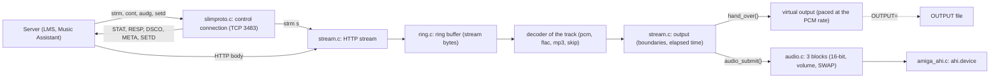

# Architecture of amisqueeze

For contributors: how amisqueeze works, and why this way. The code comments give the details; this page gives the
picture. Building and testing are in [CONTRIBUTING.md](../../CONTRIBUTING.md), the steps and their decisions in the
[plan](README.md).

## The picture

amisqueeze is a Squeezebox player. A server (LMS or Music Assistant) tells it what to play, and it fetches the
sound itself. It runs as one task, with two connections to the server, one buffer and one output:

- the control connection (slimproto, TCP 3483) carries the server's commands and the player's statuses;
- the HTTP stream brings a track's bytes into the ring buffer;
- the decoder of each track turns them into PCM, which the output hands to AHI or to the virtual output.

## Source files and builds

The **portable core** is every file of `src/amisqueeze/` but `amiga*.c` and `posix.c`. It is standard C, with no
Amiga or POSIX header. Whatever touches the system goes through `platform.h`: sockets, clock, files, the audio
device, the wait.

| File | Role |
|---|---|
| `player.c` | set-up from the options, the main loop, reconnection, the FLAC and MP3 decision at start-up; the parts of the Amiga start-up that need no system (ToolTypes, window specification, message history, close gadget's event), so that the unit tests reach them |
| `slimproto.c` | the control connection: framing, incoming packets, `HELO`, `STAT`, `RESP`, `DSCO`, `SETD` |
| `stream.c` | the HTTP stream, the queue of tracks, the output (which decoder runs, track boundaries, elapsed time, statuses), the virtual output |
| `icy.c` | an internet radio's parts that need no system: the HTTP status line, the metadata blocks taken out of the sound, the title in them |
| `ring.c` | the 1 MB ring buffer of stream bytes |
| `decoder.c`, `flac.c`, `mp3.c` | the decoders: raw PCM (and a WAV header), FLAC (dr_flac), MP3 (minimp3, `AMISQUEEZE_MP3` only) |
| `audio.c` | the audio output's blocks: order, conversion to 16-bit big-endian, volume, `SWAP`, bytes played, pause |
| `bench.c` | the decoding speed (built-in samples `bench_flac.c`, `bench_mp3.c`), for `AUTO` and `BENCH` |

`platform.h` has three implementations:

- on the Amiga, `amiga.c` and `amiga_ahi.c`. `amiga.c` uses bsdsocket.library (`WaitSelect()`), timer.device and
  dos.library, and holds the entry point ([The Amiga side](#the-amiga-side-start-up-window-commodity)).
  `amiga_ahi.c` holds the ahi.device calls;
- `posix.c`, the host build, for tests and debugging. It has no audio device: its entry point never asks for the
  audio output, so it always uses the virtual output. `UNIT`, `NOAUDIO` and `SWAP` are accepted and ignored;
- `tests/stub_platform.c`, for the unit tests (`tests/test_core.c`). It simulates the clock and the sockets. Its
  fake audio device counts the requests ahi.device would mishandle (`stub_audio_bad`).

The same sources give three programs:

| Program | Built for | Decodes |
|---|---|---|
| `out/amisqueeze` | 68020 | PCM, FLAC |
| `out/amisqueeze.fpu` | 68020 and 68881 (`AMISQUEEZE_FPU`, `AMISQUEEZE_MP3`) | PCM, FLAC, MP3 |
| `out-host/amisqueeze` | the host (`posix.c`), with ASan and UBSan | PCM, FLAC, MP3 |

Why `amisqueeze.fpu` decodes MP3: [Formats and conversions](#formats-and-conversions).

## The main loop

amisqueeze is one task running one loop, `run()` in `player.c`. Each turn waits for the network, then:

1. reads the control connection's packet, if one came;
2. reads or writes the stream socket, if it is ready and the control packet closed no stream (`stream.closes`);
3. feeds the output (`output_tick()`);
4. reconnects if nothing came from the server for 35 s.

**The wait** (`plat_wait()`) watches the control socket, and the stream socket while there is one. The stream
socket is watched for writing while it connects, for reading once the ring has room enough. The wait ends after
100 ms while something streams or plays, or while a socket is left out (below), and after 1 s otherwise. On the
Amiga, the end of an AHI request ends it too, and so do the window's and Exchange's events.

**No socket blocks**, except during the control connection's `connect()`. A read that finds nothing
(`PLAT_AGAIN`) is no error: that socket is left out of the waits for 100 ms (`AGAIN_WAIT_MS`).

**Ctrl-C always stops amisqueeze**, in `connect()` and in the wait too. Both may return EINTR, which
`plat_interrupted()` takes as the stop request itself.

Addresses and ports are in host byte order in the core. Only the platform layers convert them.

**Why**

- A TCP/IP stack may report a socket readable while nothing can be read yet. AmiNetXDuo does so after a lost
  segment, because it counts the segments that arrived out of order. A blocking read would wait for the missing
  segment. If the server is gone, it would wait forever, and the 35 s check would never come.
- Leaving that socket out for 100 ms keeps the loop from spinning while the stack keeps reporting it.
- EINTR counts as the stop request because a stack may clear the Ctrl-C signal. AmiNetXDuo's `WaitSelect()` also
  returns EINTR for a Ctrl-C pressed before the wait started, without the signal in the mask it gives back.
- The control packet may close or replace the stream, and a new socket may take the old one's number. So the
  stream socket's readiness counts only if no stream was closed in between.

## The data path, step by step

1. **`strm s`** gives the stream's address, the HTTP request, the format and a threshold. Address 0 means the
   control connection's. `stream_start()` queues a track at the ring's write position and connects without
   blocking. The request is sent as is, and the response headers go back to the server in `RESP`.
2. **The ring buffer** holds the stream as received, several tracks back to back, which makes playback gapless.
   When it is full, TCP slows the server down. `STAT` reports this one buffer both as the stream buffer and as the
   output buffer.
3. **The output** starts once `threshold` bytes have arrived, or the whole track. It asks the decoder of the track
   at the ring's read position for PCM. A decoder never reads past its track's end (`until_next_track()`). A track
   whose decoder cannot start gets the `skip` decoder, which drops its data.
4. **The sink** takes the PCM. It is one of two:
   - the virtual output (host build, `NOAUDIO`, `OUTPUT`) consumes it at the PCM rate, as a sound card would,
     through `hand_over()`;
   - the audio output fills `audio.c`'s blocks with whole frames of one track. At most two are with the device,
     one playing and one linked to it, and one is filled in advance. That is about 0.6 s of sound in all.

`OUTPUT` writes its file in `hand_over()` only. It keeps the virtual output, so that the file holds exactly what
was handed over.

**Why** the stream socket is read only once 8 KB of the ring are free (`READ_MIN_SPACE`, a quarter of a smaller
ring): the output frees a few hundred bytes at each turn, and reading them at once kept the loop awake. While the
response headers come, 4 KB must be free, since body bytes may follow them in the same read.

## Two kinds of position

A decoder turns N bytes of the stream into M bytes of PCM. So positions are counted in two units, which must
never be mixed:

- **the ring's, in bytes of the stream**: `ring.total_in` and `ring.total_out` (since the last `ring_clear()`,
  whatever the wrap-around), `track.start` (where a track's data begins), `decoder.track` (the track being
  decoded). `strm f` truncates the ring at a `track.start`;
- **the output's, in bytes of decoded PCM**: `out.handed` (handed to the sink since the last reset),
  `track.out_start` (where the track begins in the output), and the bytes played (`sink_played()`). The bytes
  played are an estimate from the AHI blocks, or `handed` for the virtual output.

**The link between them** is made when the reading reaches a queued track (`reach_tracks()`). Once the decoder
holds nothing more of the previous track (`finished`), that track's `out_start` is set to `handed`. The decoder
must say so, since dr_flac and minimp3 read ahead.

- The boundary is reported (`STMs`) when the bytes played reach it (`next_track_due()`).
- Elapsed time is `(played - cur.out_start)`, at the rate of the decoded format.

Raw PCM has the same size on both sides, which hides a mix-up. The test-only "widening" decoder of
`tests/test_core.c` makes the output bigger than the input, and reveals it.

## Decoders

What each decoder needs from its caller:

- **Raw PCM** (`decoder.c`): a WAV header at the start of a PCM track gives the format, whatever `strm s` says.
- **FLAC** (`flac.c`, dr_flac): dr_flac takes a short read for the end of the stream, and reads ahead (a 4 KB
  cache). So a frame is decoded only when the ring holds a whole one, and a track ends for the output only when
  the decoder says `finished`.
- **FLAC after a seek or a resume**: LMS sends the file from a frame boundary, without its header. `flac.c` makes
  up a STREAMINFO from the first frame's header. It refuses a frame whose header leaves its rate or its sample size
  to STREAMINFO.
- **MP3** (`mp3.c`, minimp3, `AMISQUEEZE_MP3` only): minimp3 resets itself when the bytes after a frame are not the
  next header. So it is called only with a frame and the next header in its 16 KB staging buffer, or at the end of
  the track. The first frame waits for a full buffer.
- **MP3 without gaps**: the LAME header of the first frame gives the encoder's delay and padding to drop
  (`mp3_lame_header()`). After a seek, LMS sends that frame again first, so the end limit is never reached.

## AHI

`audio.c` (portable) fills the blocks; `amiga_ahi.c` makes the ahi.device calls. They keep these rules, learnt
from the source of ahi.device (AHI 6.0):

- chain a request (`ahir_Link`) only to one already **playing**. Linked to a waiting one, it never plays nor ends.
  Hence at most two requests with the device;
- abort the **playing** one first: it takes the linked one along. The reverse order leaves a stale reference that
  hangs the device;
- `CMD_STOP` does not pause what is playing. A pause aborts the requests, and the rest is sent again on resume;
- a non-real-time mode ("Filesave") on a device unit writes only silence;
- `ahir_Volume` is always full. With AHI 6.6 and `paula.audio`, requests sent again after an abort (a resume) with
  a low volume corrupt the free memory list: the system hangs, or amisqueeze dies later. `audio.c` scales the
  samples instead, with two 256-entry tables and no multiplication per sample.

The fake audio device of the unit tests counts the requests that break the first two rules (`stub_audio_bad`).

## The Amiga side: start-up, window, commodity

`main()` in `amiga.c` reads the options, opens the system's resources, then calls `player_main()`:

1. the options come from `ENV:amisqueeze.prefs`, then from the command line or, from the Workbench, from the
   icon's ToolTypes. All are read with the same template (`ReadArgs`). The command line or the ToolTypes win over
   the prefs;
2. amisqueeze becomes a commodity, one at a time. A second start finds the first one (`CBERR_DUP`) and does
   nothing to it. `BENCH` skips this step;
3. `LOG` opens its file, then timer.device and bsdsocket.library are opened.

**The commodity**: "Remove" in Exchange stops amisqueeze, like Ctrl-C. Disable and Enable show in Exchange only,
the music goes on. Show and Hide exist only with a window of amisqueeze's own (`COF_SHOW_HIDE`).

**The message window** exists when amisqueeze is started from the Workbench, or from a Shell into `NIL:`
(`Run >NIL:`). From another Shell, the messages go to that Shell.

- From the Workbench, it opens at the first message, unless `QUIET`.
- With `QUIET` or `NIL:`, it stays hidden. A message during start-up opens it, until bsdsocket.library is open.
- Exchange's Show and Hide open and close it. Its close gadget closes it too, and the music goes on.
- The last 512 bytes of messages are kept (`struct history`), and shown again when it opens.
- An error in the player's start-up opens it: `PORT`, `MAC`, server not found, ahi.device... (`PLAYER_FAIL`).
- At the end, a window shown stays until it is closed.

**How it works**: the window is in RAW mode, with an asynchronous read always pending. The read ends at a key,
which is ignored, or at the close gadget's event, which closes the window. Hide first sends `ACTION_FORCE`,
which puts a byte into the window's input and so ends the pending read. `AUTO` and `WAIT` are taken out of
`WINDOW`: amisqueeze waits itself, at the end, for a shown window to be closed.

**Why**

- Everything runs in one task, since the `SocketBase` belongs to the task that opened bsdsocket.library.
- In the usual (cooked) mode, a key typed without Return holds every write to the window until Return, and
  amisqueeze's one task with it.
- `Close()` with a read pending never gets the read back.
- `WAIT` does not hold `Close()`, so a window with `WAIT` could not be hidden.
- Showing the window holds the one task long enough to stop the sound for a moment on a slow 68020. Hence only
  512 bytes are kept, about a window's worth.

What was tried, with which systems, the measurements, and the libnix side of the Workbench start: CONTRIBUTING.md,
[Pitfalls](../../CONTRIBUTING.md#pitfalls).

## Slimproto: the messages

**Framing**: from server to client, a 2-byte length, then a 4-byte opcode and the data. From client to server, the
opcode, a 4-byte length, then the data. Every field is serialised byte by byte, big-endian, without packed
structures.

**Sent**:

- `HELO`: device id 12 (SqueezePlay), the MAC, uuid and byte counts at 0. The MAC is derived from the name, unless
  `MAC`. On a reconnection, `0x4000` is set in the channel list;
- `HELO`'s capabilities:
  - `Model=squeezelite`, so that LMS recognises the player;
  - `ModelName=AmiSqueeze`, `Firmware=<version>`, `AccuratePlayPoints=0`;
  - `HasDigitalOut=1`, so that LMS offers its fixed volume setting;
  - `MaxSampleRate` and the formats ([Formats and conversions](#formats-and-conversions));
- `STAT` ([the statuses](#a-tracks-life-the-statuses)), `RESP`, `DSCO`, `META` (a radio's metadata block),
  `SETD` (the player name).

**Received and handled**:

- `strm s`: autostart, format (`p`, `f`, `m`), sample size, rate and channel codes, endianness, threshold, port,
  address, request. The other fields are ignored: S/PDIF, transition, flags, output threshold, replay gain;
- `strm t`, `q`, `f`, `p` (interval 0), `u`;
- `cont`: the blocks' interval (32 bits), a `loop` byte, a count of GUIDs (16 bits), the GUIDs. Only the interval
  is used. The `loop` byte, and a `cont` with no stream waiting for it, are said with `VERBOSE`;
- `audg`: the 16.16 gains, already on the server's volume curve, which `audio.c` applies to the samples. Adjust 0
  means a fixed volume: the samples are left untouched. ahi.device always gets full volume ([AHI](#ahi));
- `setd` id 0: the player name, set or queried. It is answered with `SETD`.

**Received and ignored on purpose**:

- `aude` (S/PDIF and DAC on or off): printed with `VERBOSE` only;
- `vers`, `grfb`, `grfe`, `codc`, which Music Assistant sends: `<- ... ignored` with `VERBOSE` only, since they
  would read as errors;
- `strm a` (skip ahead) and `strm p` with an interval, which serve synchronised players. `strm u` resumes at
  once, whatever time it gives.

**Not handled**: `serv`, LMS's `body`, and any other opcode. The message "not handled" is always shown, and
nothing is done. LMS sends `body` for a playlist address played directly, asking for the body back.

**Not done at all**: synchronisation between players, displays and IR, HTTPS.

## A track's life: the statuses

What the server expects, as squeezelite behaves (written from the protocol, not from its code):

1. `strm s` -> `STMf`; connected and request sent -> `STMc`; response headers -> `RESP`. For a status outside
   2xx, see [internet radios](#internet-radios).
2. Threshold reached: autostart 1 -> `STMs`; autostart 0 -> `STMl`, then `strm u` -> `STMr` (and `STMs`).
   Autostart 3 and 2 (a direct stream) are the same, but nothing of the body is read before `cont`, not even the
   bytes that came with the headers. There is no time limit.
3. While playing: `STMt` every second, and in reply to each `strm t`, its timestamp echoed. `strm p` -> `STMp`,
   `strm u` -> `STMr`.
4. End of the HTTP body -> `DSCO` 0 + `STMd`. The server then sends the next track's `strm s`. Its data is
   appended to the ring, and `STMs` is sent again when the output reaches it.
5. Buffer and sink empty: `STMo` while still streaming (the network is too slow), `STMu` once everything has been
   played. "Empty" means nothing the decoder can use: a stream that stops in the middle of a frame leaves its
   start in the ring.
6. A stream that fails sends `DSCO` with its reason: 1 local, 2 remote, 3 unreachable.

Three rules follow from what the server does.

**`strm f` drops only the last queued track**, since `STMd` comes at the end of the data received, not at the
end of the decoding as with squeezelite:

- its stream is closed without `DSCO`, and its data taken back from the ring (`ring_truncate()` at its
  `track.start`);
- with the audio output, a block of it already filled plays at the end of the current track, at most about 0.6 s;
- with nothing playing, `strm f` is a stop.

Why: with a 1 MB ring, the server's next `strm s` comes while up to 1 MB of the current track is still waiting in
the same buffer. That is about 6 s of PCM, 9 s of FLAC. When LMS changes its mind about the next track (removed,
moved, reshuffled), it sends `strm f` and expects the playing track to go on. Clearing the ring would cut it.

**A `strm s` refused at once is answered `STMf`, `STMc`, then `STMn`** (`slim_send_refusal()`), as by a player
whose decoder fails once the stream has started. LMS then moves on to the next track; Music Assistant ignores
`STMn`. A `strm s` is refused for a format this build does not decode, a request over 1 KB, or 16 tracks already
waiting. Why: LMS drops every status after a `strm s` until `STMc`, its stream start.

**At most 16 tracks wait in the ring** after the one playing (`MAX_TRACKS`), and one more is refused. Why so
many:

- LMS sends its second song only after the first one's `STMs`. But it fetches a radio that drops again at once
  with a new `strm s` each time;
- Music Assistant sends another track each time the one after the track playing changes in its queue, or
  crossfade is switched, once the waiting one has fully arrived.

Why refuse rather than forget the oldest: its data would go to the decoder of the track before it.

## Formats and conversions

amisqueeze tells the server which formats it decodes, and the highest rate it takes. The server then sends some
files as they are and converts the others.

- `HELO` announces `pcm` always, then `flc` and `mp3` as decided at start-up: `FLAC` and `MP3` options, `AUTO`
  measuring the speed. Its `MaxSampleRate` is 48000, or what `MAXRATE` asks.
- LMS then sends FLAC and MP3 files as they are (formats `f`, `m`), and WAV and AIFF as raw PCM with their headers
  stripped. It converts the rest.
- For `f` and `m`, the parameters of `strm s` are a guess until the decoder reads the stream.
- For PCM, `strm s` gives the source file's rate and sample size, whatever the conversion rule sends
  (`pcm_sample_rates`, `pcm_sample_sizes`). So the user guide's rules send WAV, whose header `decoder.c` plays.

**LMS 9.1's conversion rules**:

- a `MaxSampleRate` below a file's rate makes LMS look for a rule with the `D` (resample) capability. None of its
  rules to `pcm` has one, so it refuses the track of a player that takes PCM only. Its rules to `flc` have one;
- LMS has no default `mp3 pcm` rule, so a regular user's server cannot turn MP3 into PCM. Hence the MP3 decoder of
  `amisqueeze.fpu`. For the build without it, the rule is in the user guide's server setup;
- that rule has no `-r`: LMS tells the player the file's own rate, and forcing 44100 Hz would play 48 kHz files
  9 % too fast;
- its `FT:{START=trim %s}` lets LMS start within a track (a seek).

**An example**: an MP3 that LMS converts comes with format `p`, size `1` (16 bits), rate `3` (44.1 kHz) and
channels `2`. Its endianness is `1`, little-endian, which `audio.c` swaps for AHI. Then autostart `1`, the control
connection's address, and the request `GET /stream.mp3?player=<mac> HTTP/1.0`.

## Internet radios

An internet radio mixes metadata blocks (ICY) into its sound. Most often the server removes them: they reach
amisqueeze only on a direct stream, where the player fetches the radio itself. Read in LMS 9.1.1's and Music
Assistant 2.10.7's code:

- LMS streams directly when the player decodes the format (MP3 with `amisqueeze.fpu`), the address is `http://`,
  and the player is not synchronised. amisqueeze does not announce `CanHTTPS`;
- for a direct stream, neither the player's "Streaming Method" nor the server's `useEnhancedHTTP` ("Streaming mode
  for HTTP(S)") may ask for a proxy (`canDirectStream` in `Slim/Player/Protocols/HTTP.pm` and `HTTPS.pm`);
- otherwise LMS fetches the radio, asks for `Icy-MetaData` and removes the blocks itself (`readMetaData`);
- Music Assistant always fetches the radio, removes the blocks and keeps the title (`controllers/streams/audio.py`).

**What the servers send**: a direct stream comes with autostart 3 or 2.

- LMS sends `cont` once it has read `RESP`, with the interval of `icy-metaint`: it asked the radio for
  `Icy-MetaData`. On a 3xx it sends a new `strm s` itself. Outside 200 to 399 the stream fails (`Squeezebox2.pm`,
  `directHeaders`).
- Music Assistant sends autostart 3 or 2 for every track. After each `RESP`, even after an error, it sends `codc`
  and `cont` with an interval of 0 (`client.py`, `_process_resp`).

**The status line**: its code is the three digits after the first space, whatever the protocol (`ICY 200 OK` is a
200). Outside 2xx the body never enters the ring, and a message is always shown. Then:

- autostart 0 or 1: `DSCO` 2;
- autostart 2 or 3: `RESP` only, and the server decides. A `DSCO` would count as a second failure, or against the
  next track. A `cont` that comes anyway gets `DSCO` 2.

amisqueeze follows no redirect itself.

**The blocks**: every `interval` bytes of sound come a length byte (times 16), then the block,
`StreamTitle='...';` padded with NULs.

- Each `recv` stops where the next block begins (`icy_sound()`), so the sound goes straight into the ring.
- The length byte and the block (4080 bytes at most) go to a buffer in `struct stream`.
- The bytes that came with the headers are split the same way at `cont`.
- The threshold and `STAT` count the sound only.
- With an interval of 1000 (some radios), there is a `recv` every 1000 bytes at most.

**The titles**: LMS learns a direct stream's titles only from the player. Each block that is not empty goes back
in `META`, as received. LMS reads `StreamTitle` in it (`Protocols/HTTP.pm`, `parseMetadata`), shows it and gives
it to remotes. On the console, with `VERBOSE`, in ASCII.

## Server discovery

Without `SERVER`, amisqueeze broadcasts a UDP request to 255.255.255.255 on `PORT`. It listens for 2 s, then
connects to the first server that answered; up to 8 are kept and shown.

- The request is `e`, then the field `NAME` with no value: a 4-byte tag, a 1-byte length.
- LMS (`Slim/Networking/Discovery.pm`) and Music Assistant (aioslimproto's `discovery.py`) both answer on their
  slimproto port, with `E` and the fields asked for. Every reply starting with `E` counts.
- Neither sends its slimproto port. So the reply's source address is the server's, and `PORT` serves both the
  request and the connection.
- `NAME` is only shown, read within the packet's bounds. Music Assistant writes its length in characters, then
  encodes the whole packet in UTF-8. A name outside ASCII thus gives a wrong length; from 128 characters, the
  length byte itself takes two.
- The older request `d` (the Squeezebox's) is not used: its reply carries only the host name, 17 bytes.
- A discovered server is looked for again when a connection to it fails, not after a lost connection: the same
  address is tried first.

A router does not pass a broadcast on. Some NATs, the bridge of a container host for instance, rewrite a
broadcast's source, so that the replies are lost.

## Music Assistant's differences

Music Assistant (seen with 2.10.7) speaks the same protocol, with differences. It transcodes everything to the
output codec set for the player: `flac` by default, `mp3`, `aac`, `wav` (its `constants.py`,
`CONF_ENTRY_OUTPUT_CODEC`).

- `strm s` comes without the stream's parameters for FLAC and MP3, with autostart 2 or 3. Then `codc` (the codec)
  and `cont` follow the response headers. amisqueeze reads the body once `cont` has come. With autostart 2, MA
  then sends `strm u`.
- Its `wav` output codec sends a WAV header, 24 bits while `strm s` says 16. `decoder.c` reads the header at the
  start of each PCM track and plays its format.
- Its `mp3` codec has no LAME header, so it is not gapless. `aac` is refused (`STMn`, which MA ignores).
- It sends `strm f` then `strm q` before each new track, and `audg` 50 at each connection, then the player's
  volume.
