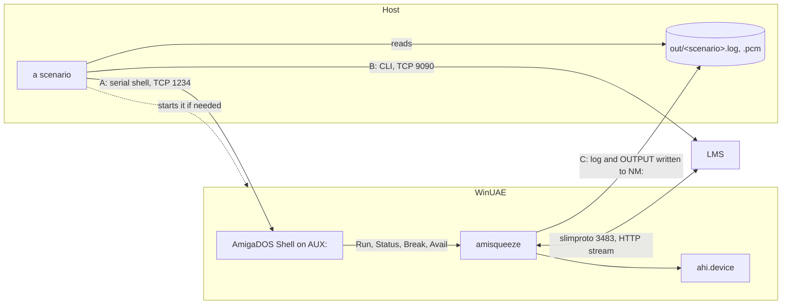
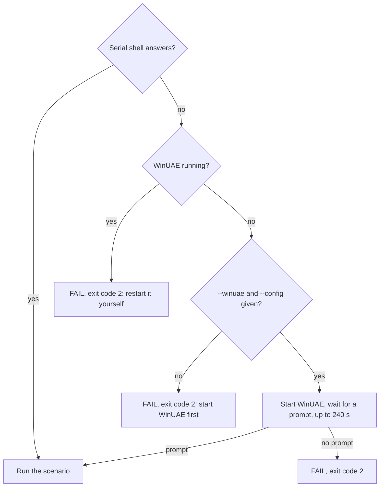
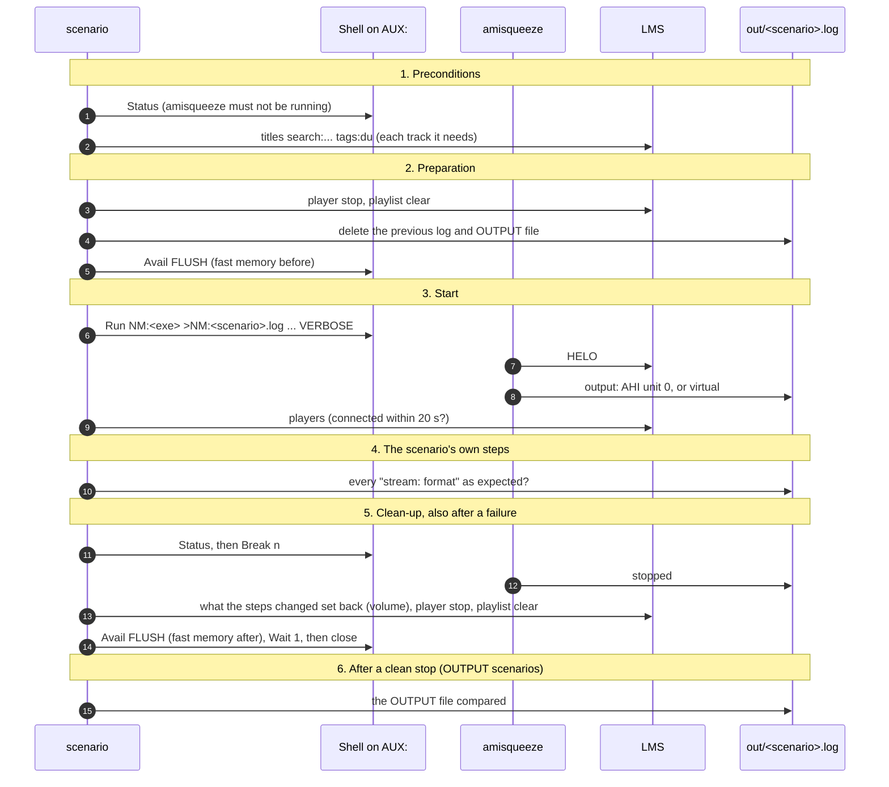
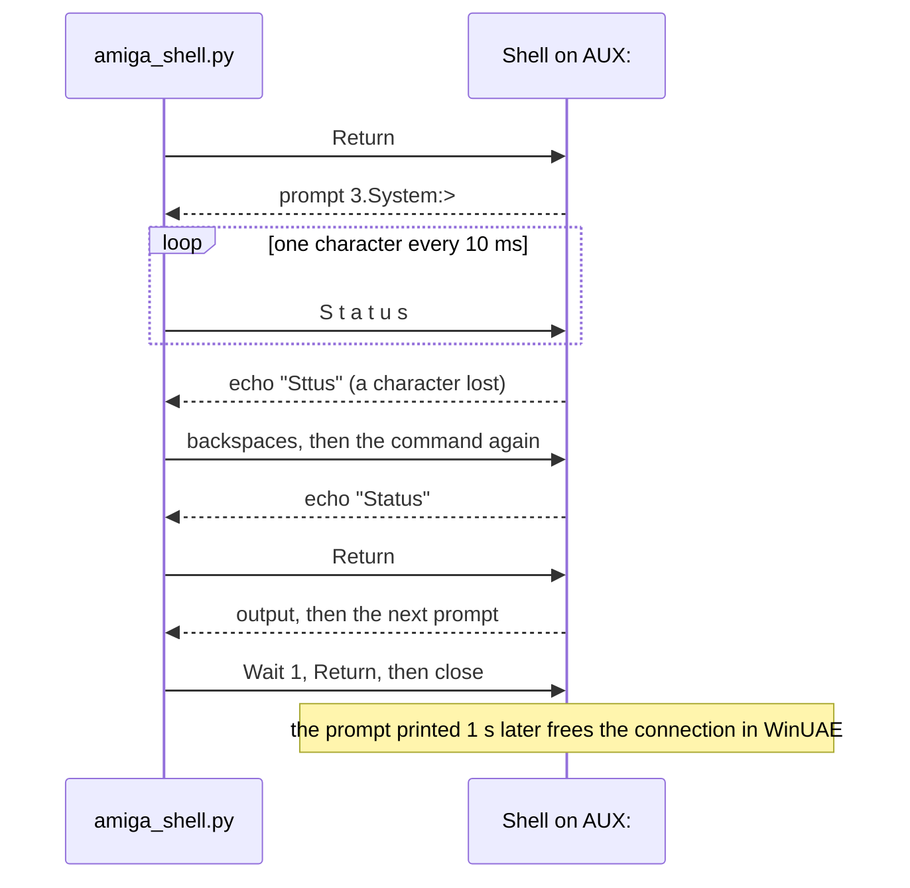

# Automated scenarios in WinUAE

`tools/winuae/` runs tests in WinUAE from the host and prints their result: `OK`, or `FAIL:` and the reason, with
an exit code. They replay before a release what `make test` cannot check: the Amiga platform layer (AHI,
bsdsocket, `Break`), a real server (LMS) and the 68k builds. One command runs them all, `run-scenarios.py`; each
scenario also runs on its own. The machine, its profiles, its AHI units and the rules of the serial shell are in
[testing.md](testing.md); the plan's steps behind these tools: tools-7 and tools-10 of
[phase-0-tooling.md](phase-0-tooling.md).

Python 3, standard library only. All six scenarios take about 4 minutes (2026-10-23, JIT + FPU profile).

| Scenario | What it checks | Time |
|---|---|---|
| `play-tone` | a test tone played through AHI unit 0 to its end, at the right speed | 20 s |
| `commands-pcm` | LMS's commands through AHI (play, volume, pause, resume, seek, stop, two tracks in a row), FLAC decoded by the server (raw PCM, the path of an Amiga without a fast CPU) | 40 s |
| `commands-flac` | the same, FLAC decoded by amisqueeze (a seek then comes without the FLAC header) | 40 s |
| `output-pcm` | the counter pattern twice, decoded by the server, written by `amisqueeze.fpu` with `OUTPUT`: identical byte by byte | 50 s |
| `output-flac` | the same, decoded by dr_flac on the 68k (`amisqueeze`) | 50 s |
| `output-mp3` | an MP3 twice, decoded by minimp3 on the FPU (`amisqueeze.fpu`): exact length, the right tone on each side | 50 s |

Every scenario also checks that the stream came in the format it tests, and that the fast memory is given back
after the stop. Not in them: Music Assistant (a scenario through its API, before 1.0), the measures (CPU load,
long runs, a slow network) and the old ROMs, which stay manual.

## The parts and how they talk



A scenario has three ways in, and never touches the traffic between amisqueeze and LMS:

- **A, the serial shell**: AmigaDOS commands typed into the Shell that `S:User-Startup` opens on `AUX:`
  ([Serial shell](testing.md#serial-shell)). It starts amisqueeze in the background, finds it with `Status`, stops
  it with `Break`, and reads the free memory with `Avail`.
- **B, LMS's CLI**: it drives the player (playlist, play, pause, seek, volume, stop) and reads what the server sees
  (connected, play mode, elapsed time, playlist index), as [The server side](testing.md#the-server-side)
  describes.
- **C, the files**: amisqueeze runs with `VERBOSE` and its output redirected to `NM:<scenario>.log`, its `OUTPUT`
  file in `NM:` too; `NM:` is the repository's `out/` folder ([The two volumes](testing.md#the-two-volumes)), so
  the scenario reads them as files on the host while amisqueeze writes them. They stay there after the run.

## Files

| File | What it is |
|---|---|
| `tools/winuae/run-scenarios.py` | runs the scenarios one after the other: the profile checked and a warm-up first, one line per scenario |
| `tools/winuae/scenario.py` | what the scenarios share, a module: options, WinUAE's start, preconditions, start and clean-up, memory, result |
| `tools/winuae/play-tone.py` | a test tone through AHI |
| `tools/winuae/lms-commands.py` | LMS's commands through AHI (`--flac off` or `on`) |
| `tools/winuae/output-compare.py` | two tracks into an `OUTPUT` file, compared (`--case pcm`, `flac` or `mp3`) |
| `tools/winuae/amiga_shell.py` | the serial shell client, a module; also a command line tool: `python3 tools/winuae/amiga_shell.py "Version"` prints the output of one command |
| `tools/winuae/lms_cli.py` | the LMS CLI client, a module: one command and its decoded answer, a player's id from its name, a track from its file name |

## Running them

What they need:

- **The profile**: the JIT and a 68882 with `compfpu`, the JIT profile of [Profiles](testing.md#profiles) plus
  `-s fpu_model=68882 -s compfpu=true`: `amisqueeze.fpu` needs the FPU, and decoding on the Amiga must run at least
  twice real time (FLAC runs at 0.2x without the JIT). `run-scenarios.py` checks it with `NM:amisqueeze.fpu BENCH`
  and stops (exit code 2) on another profile. Paula through AHI works in it as well.
- **The builds**: `amisqueeze` and `amisqueeze.fpu` in `out/` (`make`).
- **AHI unit 0** set up (any mode; `Paula:14 bit stereo++` in [AHI](testing.md#ahi)).
- **An LMS server running** before the scenarios start (tested with LMS 9.1.1), see below.

The server must be Lyrion Music Server: Music Assistant cannot run these scenarios (its LMS-like CLI cannot start
a library track; its own scenario comes before 1.0). What the scenarios expect of it:

- **Reachable on `127.0.0.1`** from both sides: from the host, its CLI (TCP 9090); from the Amiga, slimproto (TCP
  3483) and its web port (9000 by default), which serves the stream. With `bsdsocket_emu` the Amiga uses the
  host's network, so `127.0.0.1` is the host: run LMS on the host, or forward those ports to it. Elsewhere, give
  `--lms` (the CLI as the host reaches it) and `--server` (the server as the Amiga reaches it).
- **Its CLI open without a password**: with LMS's password protection on (Settings > Advanced > Security), the
  CLI expects a `login` first, which the scenarios do not send.
- **The [test sounds](testing.md#test-sounds) in its library**, scanned (a rescan after copying them):
  `tone-440.flac`, `tone-440-48k.flac`, `sweep.flac`, `test-pattern.flac`, `test-20s.mp3`. Nothing else: no
  `mp3 pcm` conversion rule is needed (MP3 is decoded on the Amiga).
- **A player of its own**: the scenarios drive the player named `--name` (`Amiga` by default): they stop it,
  clear its playlist and change its volume (set back at the end). Do not run them while someone listens through a
  player of that name.

An LMS that does not answer stops a scenario at once with exit code 2 ("no LMS CLI on 127.0.0.1:9090").

With WinUAE already started in that profile:

```
python3 tools/winuae/run-scenarios.py
```

Or let it start WinUAE (see [Starting WinUAE](#starting-winuae)); `WINUAE` and `WINUAE_CONFIG` in the environment
stand for `--winuae` and `--config`:

```
python3 tools/winuae/run-scenarios.py --winuae <WinUAE folder>/winuae64.exe --config <your copy>.uae --winuae-arg "-s cpu_24bit_addressing=false -s cachesize=16384 -s cycle_exact=false -s cpu_cycle_exact=false -s cpu_memory_cycle_exact=false -s cpu_speed=max -s cpu_compatible=false -s fpu_model=68882 -s compfpu=true"
```

One scenario on its own, or a few:

```
python3 tools/winuae/lms-commands.py --flac on
python3 tools/winuae/run-scenarios.py --only output-flac output-mp3
```

The options every scenario takes, and `run-scenarios.py` passes on:

| Option | Default | What it sets |
|---|---|---|
| `--name` | `Amiga` | the player's name (`NAME=`), always given, so that `ENV:amisqueeze.prefs` cannot change it |
| `--server` | `127.0.0.1` | the server as the Amiga reaches it (`SERVER=`) |
| `--lms` | `127.0.0.1:9090` | LMS's CLI as the host reaches it |
| `--serial` | `127.0.0.1:1234` | the serial shell (`win32.serial_port` of the configuration) |
| `--nm-dir` | the repository's `out/` | the host folder mounted as `NM:` |
| `--memory-slack` | `16` | KB of fast memory, free or in the largest block, that may be missing after the stop |
| `--winuae`, `--config` | `WINUAE`, `WINUAE_CONFIG` from the environment | WinUAE's executable and the test configuration, to start it if needed |
| `--winuae-arg` | none | more WinUAE arguments, repeatable: the profile's `-s name=value` lines |
| `-v` | off | prints every exchange with the shell and the CLI |

And their own:

| Scenario | Option | Default | What it sets |
|---|---|---|---|
| `run-scenarios.py` | `--only NAME...` | all | the scenarios to run, by the names of the table above |
| `play-tone.py` | `--exe`, `--unit`, `--extra`, `--track`, `--timeout` | `amisqueeze`, `0`, none, `tone-440.flac`, track length + 30 s | the program in `NM:`, the AHI unit, more amisqueeze options as typed in a Shell (`"SWAP FLAC=OFF"`), the file to play, how long to wait for its end |
| `lms-commands.py` | `--flac` | `off` | FLAC decoded by the server (`off`, raw PCM) or by amisqueeze (`on`) |
| `lms-commands.py` | `--exe`, `--unit`, `--extra` | `amisqueeze`, `0`, `SWAP` | as for `play-tone.py` |
| `output-compare.py` | `--case` | required | `pcm`, `flac` or `mp3` (see [output-compare](#output-compare)) |

## Starting WinUAE

**No scenario ever stops a running WinUAE**: it cannot know which configuration that one runs on the hard file,
and two configurations on the same hard file corrupt it ([The test machine](testing.md#the-test-machine)). Nor can
it change the profile of a running one: restart it yourself in the right profile.



`run-scenarios.py` does this once, before the first scenario. A WinUAE started by a script keeps running
afterwards, ready for the next run.

## What every scenario does

`scenario.py` runs the steps every scenario shares around its own (`Scenario.run()`):



| Step | Check | When it fails |
|---|---|---|
| 1 | the program is in `NM:`, the serial shell gives a prompt, LMS's CLI answers | exit code 2 |
| 1 | each track is in the server's library: among the answers to `titles ... search:`, the one whose URL ends with `/<track>` (no server path needed) | exit code 2 |
| 1 | amisqueeze is not running already (`Status`); the scenario leaves it alone | exit code 2 |
| 3 | the player is connected in LMS within 20 s | exit code 1 |
| 3 | the log's `output:` line is the expected one: `AHI unit <n>`, or `virtual` with `OUTPUT` | exit code 1 |
| 4 | every `stream: format <c>` line of the log gives the format under test: `p` raw PCM, `f` FLAC, `m` MP3 (not checked by `play-tone`, whose format depends on the profile): a FLAC "decoded on the Amiga" that LMS sent as PCM would pass the rest | exit code 1 |
| 4 | `output: buffer empty, waiting for data` (an underrun) | reported, not a failure |
| 5 | `stopped` in the log, amisqueeze gone from `Status` | exit code 1 |
| 5 | after the stop, the fast memory free and its largest block (`Avail FLUSH`) are what they were before the start, within `--memory-slack` | exit code 1 |

The clean-up (step 5) runs whatever happened before, from the moment `Run` was typed: a player left playing in
LMS would start again with the next run of amisqueeze ([The server side](testing.md#the-server-side)).

### Free memory

`Avail FLUSH` expunges the libraries and devices no longer open, then gives the free memory; the scenario compares
the fast memory's `Available` and `Largest` columns before the start and after the stop. A corrupted free memory
list shows first in `Largest`: it is how step player-6 found the AHI defect of a low `ahir_Volume` (see
`lms-commands`). What was seen while setting the tolerance (2026-10-22, JIT + FPU profile):

- **The first AHI run after a boot** keeps about 12 KB that `Avail FLUSH` never gives back (AHI's, not
  amisqueeze's: a run without sound keeps nothing, the next AHI runs give everything back); in the middle of the
  free memory it can also cut the largest block (1.4 MB less once). `run-scenarios.py` therefore starts and stops
  amisqueeze on AHI unit 0 once (the warm-up) before the scenarios; a scenario run on its own right after a boot
  may fail this check: run it again.
- **`Run` itself** sometimes keeps 1,064 bytes (seen with `Run >NIL: Wait 3` as well): under the 16 KB of
  `--memory-slack`.

### Elapsed time: intervals only

WinUAE's clock falls behind real time, and LMS's elapsed time is wrong for about 50 s after a start or a seek
([The server side](testing.md#the-server-side)). So no scenario compares `time ?` with an absolute value: it
compares how much the elapsed time grows between two readings with the time between them on the host (0.6 to player-4
times: the slow profile's clock lost about 23 % in a test), and times whole tracks by the host's clock. What these
checks catch is an elapsed time that stays still, or one that runs twice too fast or too slow (a wrong sample
rate). A seek is judged by the playlist index, never by `time ?`.

## The scenarios

### play-tone

`playlistcontrol cmd:load` of the track, then:

| Check | When it fails |
|---|---|
| `mode ?` gives `play`, and the elapsed time grows with the host's clock over 3 s (a third of the track if shorter) | exit code 1 |
| `output: end of playback` appears between the track's length minus 1 s and plus 10 s after `play`, by the host's clock | exit code 1 |
| `mode ?` gives `stop` afterwards | exit code 1 |

### lms-commands

The playlist `sweep.flac` (20 s), `tone-440.flac`, `tone-440-48k.flac` (10 s each), amisqueeze on AHI unit 0
with `SWAP` and `FLAC=OFF` (`commands-pcm`) or `FLAC=ON` (`commands-flac`); LMS's volume set to 100 first, and
set back afterwards to what it was.

| Step | Command | Check |
|---|---|---|
| 1 | `play` | mode `play`, the elapsed time grows with the host's clock |
| 2 | `mixer volume 50` | a `volume:` line below 100 % in the log |
| 3 | `pause 1` | mode `pause`, the elapsed time still (less than 0.3 s in 3 s) |
| 4 | `pause 0`, then `mixer volume 100` | mode `play`, the elapsed time grows again (measured 1 s after the resume: LMS's takes a moment to move); `volume: 100.0 %` in the log |
| 5 | `time <length - 1.5>` | the next track (index 1) starts within 6 s; at least 9 s of the sweep were left, by the host's clock, so it could not have ended on its own |
| 6 | `stop` | mode `stop` |
| 7 | `play` | the last track (index 2) starts: two tracks in a row, 44.1 then 48 kHz; `output: end of playback` between 19 and 30 s after `play`; mode `stop` at the end |

The pause and resume matter beyond LMS's commands: in step player-6, LMS's fade to 0 before a pause made the requests
AHI got again on resume carry a near-zero `ahir_Volume`, and `paula.audio` then corrupted the free memory list
(the largest block fell from 5.7 MB to 0.5 MB right after the resume). amisqueeze now always gives AHI full volume
and scales the samples itself. **This scenario does not catch that defect if it came back**: tried on
2026-10-23 with `ahir_Volume` following the volume again (0.0 % at the resume, after LMS's fade), `commands-pcm`
passed, the free memory and its largest block unchanged to the byte (JIT + FPU profile; in step player-6 the defect
showed after an hour's run, then in a short sequence on a freshly started WinUAE). What guards against it is the
constant full volume in `plat_audio_send()` (`amiga_ahi.c`) and its comment. The volume 50 checks that LMS's volume
reaches amisqueeze (`audg`) and that the pause works with scaled samples; the fade comes with any volume.

### output-compare

amisqueeze with `OUTPUT=NM:output-<case>.pcm` (the virtual output, no sound), the track twice in the playlist and
a single `play` (the rules of `OUTPUT` comparisons in
[testing.md](testing.md#checks-the-host-tests-cannot-make)); the end of playback awaited within
the tracks' length + 30 s, then amisqueeze stopped, `bytes written` awaited in the log, and the file compared.

| Case | Program, options | Track | Stream | Compared with |
|---|---|---|---|---|
| `pcm` | `amisqueeze.fpu FLAC=OFF MP3=OFF` | `test-pattern.flac` | `p`, decoded by the server | the counter pattern twice, byte by byte |
| `flac` | `amisqueeze FLAC=ON` | `test-pattern.flac` | `f`, decoded by dr_flac on the 68k | the counter pattern twice, byte by byte |
| `mp3` | `amisqueeze.fpu MP3=ON` | `test-20s.mp3` | `m`, decoded by minimp3 on the FPU | the tones it holds (see below) |

- **The counter pattern** is made again at each run (`tools/pcm-compare.py --write-counter`), and the file
  compared with it twice in a row by `pcm-compare.py --counter`: no reference file to keep. Audio decoded on the
  Amiga is written in its byte order (big-endian): the scenario turns it round before comparing.
- **MP3 decoded on the Amiga cannot be compared byte by byte**: its floating point gives a few samples off by one
  from any other decoder (0.03 % of them against the host build, step player-8c), and the server's `sox` is another
  decoder, which keeps the encoder's delay. So the file must have the exact length of the two tracks (2 x 882,000
  frames: the gapless trim leaves each track its signal's length), and each side of each track must be its tone
  (440 Hz on the left, 660 Hz on the right): the sine that fits it best (amplitude, phase and offset free) must
  be at 0.4 to 0.6 of full scale, with a signal-to-noise ratio of at least 60 dB. Measured on 2026-10-22: 0.475 of
  full scale, 72 and 77 dB; the server's `sox` decoding, untrimmed, gives 26 dB over the same span (its delay is
  silence where the sine is expected), 56 to 61 dB once its delay is skipped. A side swapped, a wrong rate, a gap,
  a missing or extra frame or a corrupted decoding fails.

## run-scenarios

Before the first scenario, once:

| Check | When it fails |
|---|---|
| `amisqueeze` and `amisqueeze.fpu` in `NM:`, neither running, the serial shell answering (WinUAE started if needed) | exit code 2 |
| `NM:amisqueeze.fpu BENCH`: an FPU, and both `FLAC=AUTO` and `MP3=AUTO` would decode on this machine (at least twice real time) | exit code 2, with the profile to restart WinUAE in |
| the warm-up: amisqueeze started on AHI unit 0 (`NM:warm-up.log`) until `output: AHI unit 0`, then stopped | exit code 2 |

Then each scenario in its own process, its output indented; after an exit code 2 (the environment) the next ones
are not run, after a 1 they are. At the end, one line per scenario (`OK` or its `FAIL:` line, and its time), then
`OK` or `FAIL:` and the names of the scenarios that failed; the exit code is the worst of theirs.

## The serial shell client

`amiga_shell.py` follows the rules of [Serial shell](testing.md#serial-shell). One connection serves a whole
scenario:



- A command is sent only once its echo matches; after four attempts the script gives up, and the command was
  never run.
- The console's control sequences (`CSI`, a lone `0x0F`) are removed before reading; text is ISO-8859-1.
- `Run` answers `[CLI n]`, then the next prompt, which the program started in the background can follow on the
  same line with its own output: the prompt is then not at the end of what was read, and waiting for it took 30 s.
  For `Run`, the output ends at `[CLI n]` followed by a prompt anywhere (`RUN_DONE`).
- During playback the Amiga loses more characters: `Status` and `Break` are tried up to three times.

## Result

Each scenario prints its steps as they come; its last line is `OK` or `FAIL: <reason>`; after a failure, the end
of amisqueeze's log is printed above it.

| Exit code | Meaning |
|---|---|
| 0 | every check passed |
| 1 | a check failed: amisqueeze or the scenario |
| 2 | the environment: no serial shell, no LMS, a track not found, a program missing or already running, WinUAE not started or in another profile |
| 3 | usage: a wrong option |

## Adding a scenario

A new scenario is one more `tools/winuae/<name>.py`: a `Scenario` (`scenario.py`) with its program, log, tracks,
options, expected output and stream format, and a function of its own steps given to `run()` (and one for after
the stop, if it reads a file amisqueeze closes); `add_options()` for the common options; the same output and exit
codes. Then a line in `SCENARIOS` of `run-scenarios.py`, in [Files](#files) and in the table at the top.
