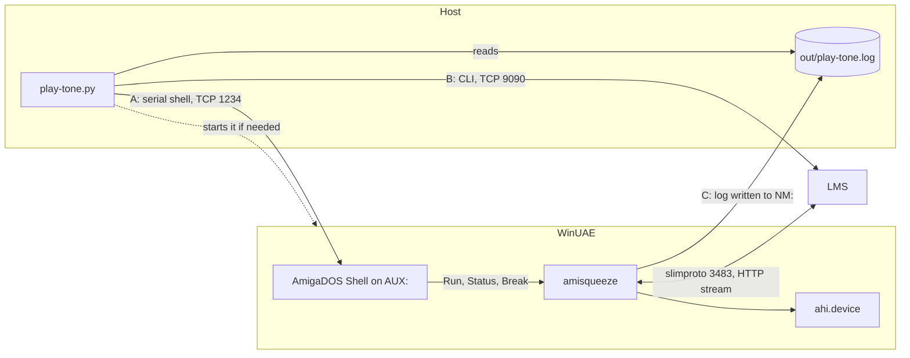
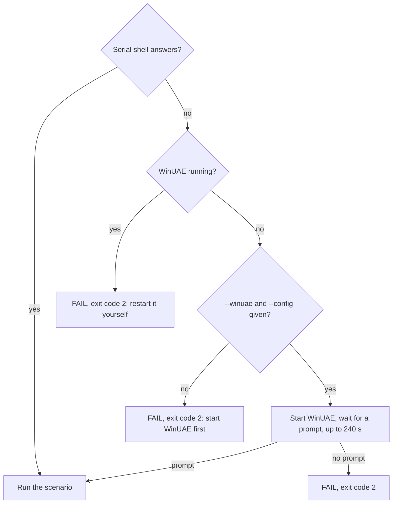
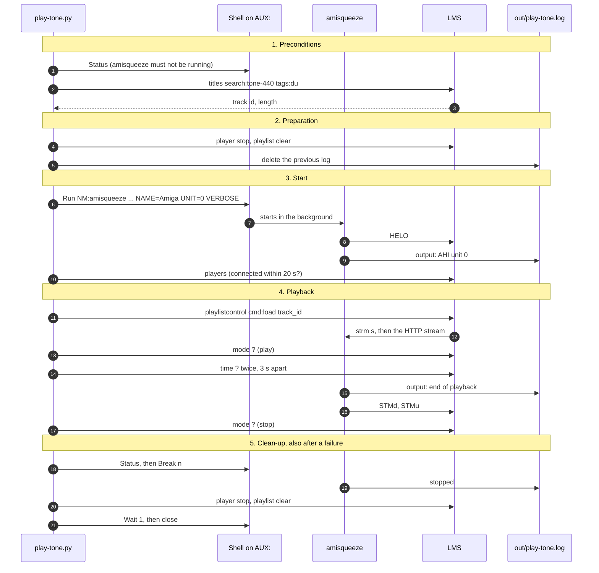
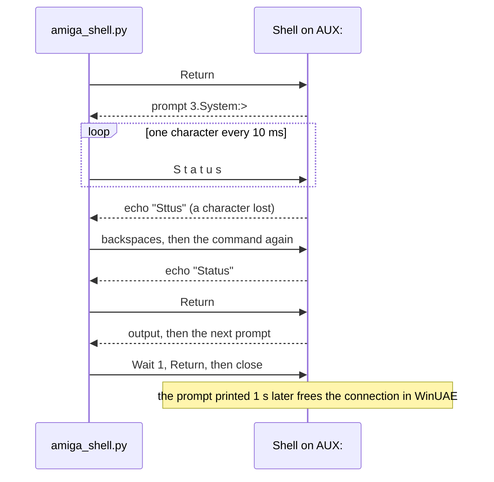

# Automated scenarios in WinUAE

`tools/winuae/` runs a test in WinUAE from the host and prints its result: `OK`, or `FAIL:` and the reason, with an
exit code. One scenario so far, `play-tone.py`: amisqueeze plays a test tone through AHI, driven by LMS, and is
stopped cleanly. The machine, its profiles, its AHI units and the rules of the serial shell are in
[testing.md](testing.md); the plan's step behind these tools: 0.7 of [phase-0-tooling.md](phase-0-tooling.md).

Python 3, standard library only.

## The parts and how they talk



The script has three ways in, and never touches the traffic between amisqueeze and LMS:

- **A, the serial shell**: AmigaDOS commands typed into the Shell that `S:User-Startup` opens on `AUX:`
  ([Serial shell](testing.md#serial-shell)). It starts amisqueeze in the background, finds it with `Status` and
  stops it with `Break`.
- **B, LMS's CLI**: it drives the player (load a track, play, stop) and reads what the server sees (connected,
  play mode, elapsed time), as [The server side](testing.md#the-server-side) describes.
- **C, the log**: amisqueeze runs with `VERBOSE` and its output redirected to `NM:play-tone.log`; `NM:` is the
  repository's `out/` folder ([The two volumes](testing.md#the-two-volumes)), so the script reads the log as a
  file on the host while amisqueeze writes it.

## Files

| File | What it is |
|---|---|
| `tools/winuae/amiga_shell.py` | the serial shell client, a module; also a command line tool: `python3 tools/winuae/amiga_shell.py "Version"` prints the output of one command |
| `tools/winuae/lms_cli.py` | the LMS CLI client, a module: one command and its decoded answer, a player's id from its name |
| `tools/winuae/play-tone.py` | the scenario |

## Running it

With WinUAE already started from the test configuration:

```
python3 tools/winuae/play-tone.py --unit 0 --extra SWAP
```

Or let the script start it, here in the slow profile (see [Starting WinUAE](#starting-winuae)); `WINUAE` and
`WINUAE_CONFIG` in the environment stand for `--winuae` and `--config`:

```
python3 tools/winuae/play-tone.py --winuae <WinUAE folder>/winuae64.exe --config <your copy>.uae --winuae-arg "-s cpu_compatible=true" --winuae-arg "-s cpu_speed=real" --winuae-arg "-s cpu_multiplier=4"
```

| Option | Default | What it sets |
|---|---|---|
| `--exe` | `amisqueeze` | the program in `NM:` (`amisqueeze.fpu` for the FPU build) |
| `--unit` | `0` | the AHI unit (`UNIT=`) |
| `--extra` | none | more amisqueeze options, as typed in a Shell: `"SWAP FLAC=OFF"` |
| `--track` | `tone-440.flac` | the file to play, from the [test sounds](testing.md#test-sounds), in the server's library |
| `--name` | `Amiga` | the player's name (`NAME=`), always given, so that `ENV:amisqueeze.prefs` cannot change it |
| `--server` | `127.0.0.1` | the server as the Amiga reaches it (`SERVER=`) |
| `--lms` | `127.0.0.1:9090` | LMS's CLI as the host reaches it |
| `--serial` | `127.0.0.1:1234` | the serial shell (`win32.serial_port` of the configuration) |
| `--nm-dir` | the repository's `out/` | the host folder mounted as `NM:` |
| `--timeout` | track length + 30 s | how long to wait for the end of playback |
| `--winuae`, `--config` | `WINUAE`, `WINUAE_CONFIG` from the environment | WinUAE's executable and the test configuration, to start it if needed |
| `--winuae-arg` | none | one more WinUAE argument, repeatable: the profile's `-s name=value` lines |
| `-v` | off | prints every exchange with the shell and the CLI |

## Starting WinUAE

**The script never stops a running WinUAE**: it cannot know which configuration that one runs on the hard file,
and two configurations on the same hard file corrupt it ([The test machine](testing.md#the-test-machine)).



A WinUAE started by the script keeps running after the scenario, ready for the next one.

## The scenario, step by step



| Step | Check | When it fails |
|---|---|---|
| 1 | the serial shell gives a prompt | exit code 2 |
| 1 | LMS's CLI answers | exit code 2 |
| 1 | the track is in the server's library: among the answers to `titles ... search:`, the one whose URL ends with `/<track>` (no server path needed) | exit code 2 |
| 1 | amisqueeze is not running already (`Status`); the script leaves it alone | exit code 2 |
| 3 | the player is connected in LMS within 20 s | exit code 1 |
| 3 | the log shows `output: AHI unit <n>`, not `output: virtual` | exit code 1 |
| 4 | `mode ?` gives `play` | exit code 1 |
| 4 | between two `time ?`, 3 s apart on the host's clock (a third of the track if shorter), the elapsed time grows by 0.6 to 1.4 times that interval (see below) | exit code 1 |
| 4 | `output: end of playback` appears between the track's length minus 1 s and plus 10 s after `play`, by the host's clock | exit code 1 |
| 4 | `mode ?` gives `stop` afterwards | exit code 1 |
| 4 | `output: buffer empty, waiting for data` (an underrun) | reported, not a failure |
| 5 | `stopped` in the log, amisqueeze gone from `Status` | exit code 1 |

The clean-up (step 5) runs whatever happened before: a player left playing in LMS would start again with the next
run of amisqueeze ([The server side](testing.md#the-server-side)).

### Elapsed time: intervals only

WinUAE's clock falls behind real time, and LMS's elapsed time is wrong for about 50 s after a start
([The server side](testing.md#the-server-side)). So the scenario never compares `time ?` with an absolute value:
it compares how much the elapsed time grows between two readings with the time between them on the host, and times
the whole track by the host's clock, from `play` to `output: end of playback`. The tolerance is wide on purpose (the
slow profile's clock lost about 23 % in a test): what the check catches is an elapsed time that stays still, or
one that runs twice too fast or too slow (a wrong sample rate).

## The serial shell client

`amiga_shell.py` follows the rules of [Serial shell](testing.md#serial-shell). One connection serves the whole
scenario:



- A command is sent only once its echo matches; after four attempts the script gives up, and the command was
  never run.
- The console's control sequences (`CSI`, a lone `0x0F`) are removed before reading; text is ISO-8859-1.
- `Run` can take about 16 s to give the prompt back: its timeout is 30 s.
- During playback the Amiga loses more characters: `Status` and `Break` are tried up to three times.

## Result

The last line is `OK` or `FAIL: <reason>`; after a failure, the end of amisqueeze's log is printed above it.

| Exit code | Meaning |
|---|---|
| 0 | every check passed |
| 1 | a check failed: amisqueeze or the scenario |
| 2 | the environment: no serial shell, no LMS, track not found, amisqueeze already running, WinUAE not started |
| 3 | usage: a wrong option |

## Adding a scenario

A new scenario is one more `tools/winuae/<name>.py` on the same model: `amiga_shell` and `lms_cli` for the
exchanges, the same preconditions and clean-up, the same output and exit codes, and a line in [Files](#files).
