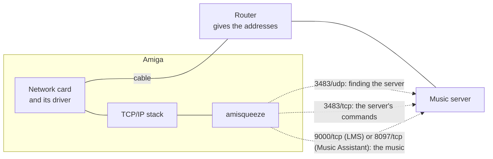

# amisqueeze - Putting the Amiga on the network

This guide takes an Amiga without network to amisqueeze playing the music of a server. Follow its sections in
order. For everything about amisqueeze itself, it links to the [user guide](user-guide.md).

**In order**: [what you need](#what-you-need) | [how it fits together](#how-it-fits-together) |
[network hardware](#network-hardware) | [getting files onto the Amiga](#getting-files-onto-the-amiga) |
[a TCP/IP stack](#a-tcpip-stack) | [checking the connection](#checking-the-connection) | [sound](#sound) |
[the server's settings](#the-servers-settings) | [first music](#first-music).

## What you need

- **An Amiga that can run amisqueeze**: see [what the Amiga needs](../README.md#what-the-amiga-needs).
- **A network card** for it, and a cable to the router: see [network hardware](#network-hardware).
- **A PC on the same network**, to download files and carry them to the Amiga.
- **A music server** on the local network: Lyrion Music Server or Music Assistant. Install it with its own guide:
  [LMS](https://lyrion.org/getting-started/) or [Music Assistant](https://www.music-assistant.io/installation/).
  What it needs for amisqueeze comes later, in [the server's settings](#the-servers-settings).

## How it fits together

The README's [how it works](../README.md#how-it-works) shows the whole picture. On the network side:



The network card needs a driver, and the TCP/IP stack drives the card through it. amisqueeze talks to the server
through the stack, on the ports above. The router gives the Amiga its address. The ports in detail: see
[ports](user-guide.md#ports).

## Network hardware

Each card needs a SANA-II driver, the standard network driver of the Amiga. AmiNetXDuo, the stack of
[the next steps](#a-tcpip-stack), brings drivers for the usual cards.

| Your Amiga | Card | Driver |
|---|---|---|
| A1200 or A600 | a PCMCIA network card | AmiNetXDuo's own for NE2000-compatible cards; it also brings the driver of Xircom cards; for other cards, the card's driver from Aminet |
| A big-box Amiga, or an accelerator with network | a Zorro card (A2065, Ariadne, X-Surf) or the accelerator's network | AmiNetXDuo's own for the usual Zorro cards; otherwise the card maker's |
| An Amiga with a PiStorm32 and Emu68 | the Raspberry Pi's Ethernet or Wi-Fi | AmiNetXDuo's own, with a recent Emu68 (see AmiNetXDuo's documentation) |
| Any other | a card with a SANA-II driver | from the card's maker, or from [Aminet](https://aminet.net) |

With a driver that is not AmiNetXDuo's, copy it to `DEVS:Networks`. What has been tried with amisqueeze: see
[what has been tried](user-guide.md#what-has-been-tried); a Xircom PCMCIA card has a
[known limit](user-guide.md#known-limits).

## Getting files onto the Amiga

Before the network works, the files must come from the PC another way. Two are needed:

- **LhA**, which unpacks `.lha` archives, and which AmigaOS 3.x does not include: `util/arc/lha.run` on
  [Aminet](https://aminet.net/package/util/arc/lha);
- **the TCP/IP stack**: AmiNetXDuo's `.lha`, from its [releases](https://github.com/tinic/AmiNetXDuo/releases).
  It takes several megabytes: more than a floppy disk holds.

The usual ways to carry them, from the PC to the Amiga:

- **A card or stick formatted FAT on the PC**, read by CrossDOS, which comes with AmigaOS 3.x. On an A1200 or
  an A600, a CompactFlash card in a PCMCIA adapter, before the network card takes the slot. The Amiga needs a
  driver for the medium: check your AmigaOS's documentation.
- **A serial cable** between the PC and the Amiga, with a transfer program on each side: the slowest way.

Then, on the Amiga, set up LhA as [installing](user-guide.md#installing) describes, and unpack AmiNetXDuo on the
hard disk (about 11 MB unpacked), for instance into `Work:`:

```
LhA x AmiNetXDuo-<version>.lha Work:
```

Once the network works, amisqueeze and AHI can come the same way, or over the network.

## A TCP/IP stack

The stack gives the Amiga its network, and amisqueeze uses it through `bsdsocket.library`. Run one stack at a
time.

### AmiNetXDuo, step by step

AmiNetXDuo is free (MIT licence) and recent. Its installer finds the card, and the router gives the address.

1. **Fit the card**, and copy its driver to `DEVS:Networks` if it is not one of AmiNetXDuo's.
2. **Run the installer**: open the drawer `AmiNetXDuo` just unpacked and double-click `Install-AmiNetXDuo`.
   Choose **Intermediate User**: it shows every card and asks whether to start the network at boot. Then:
   - the stack it proposes for your memory;
   - the installation into the system;
   - your card;
   - DHCP, the address given by the router;
   - "Yes, at boot".
3. **Reboot.** The network starts with the Amiga.

To start the network by hand instead, from a Shell:

```
AddNetInterface DEVS:NetInterfaces/eth0
```

`eth0` is the name the installer gives a network card; `List DEVS:NetInterfaces` shows the names.

AmiNetXDuo's manual, `Docs/AmiNetXDuo.guide` in its archive, tells the rest: a fixed address, other cards,
troubleshooting.

### Other stacks

- **Roadshow**: modern and commercial, from [APC&TCP](http://www.apc-tcp.de/index-de.php?page=products).
- **AmiTCP 3.0b2**: free, from 1994, `comm/net/AmiTCP-bin-30b2.lha` on
  [Aminet](https://aminet.net/package/comm/net/AmiTCP-bin-30b2). Its `README.FIRST` tells how to install it.

## Checking the connection

From a Shell, in this order. The first step that fails shows where the problem is.

1. **The address**: `ShowNetStatus` must show `Network stack: running`, and an address on the interface that is
   not `0.0.0.0`. Note its `Default route`: the router's address.
2. **The router**: `ping <router's address>` must get answers. They mean that the card, its driver and the stack
   work.
3. **The server**: `ping <server's address>`. The server's address is the one in the browser's address bar when
   its web page is open on the PC. A server may not answer `ping`: Windows' firewall, for one, blocks it by
   default. Then go on: amisqueeze's messages will tell.

`ShowNetStatus` and `ping` are AmiNetXDuo's commands; another stack has its own. If a step fails, see the
stack's troubleshooting.

## Sound

amisqueeze plays through AHI, which AmigaOS 3.x does not include. Install and set it up as
[sound (AHI)](user-guide.md#sound-ahi) describes. Without AHI, amisqueeze plays on Paula directly:
[Paula without AHI](user-guide.md#paula-without-ahi).

## The server's settings

The server needs its ports open to the Amiga, and sometimes a setting for your Amiga's speed or for MP3. Follow
[server setup](user-guide.md#server-setup), then [settings for your Amiga](user-guide.md#settings-for-your-amiga).

## First music

1. **Install amisqueeze**: see [installing](user-guide.md#installing).
2. **Start it** from a Shell: `amisqueeze`. It prints `connected to the server`.
3. **Play**: a player called "Amiga" shows up in the server's web page. Choose it there or in an app, and play.

If the player does not show up, or a track does not play: see [troubleshooting](user-guide.md#troubleshooting).
To start amisqueeze with the Amiga: see [with the Amiga](user-guide.md#with-the-amiga).
